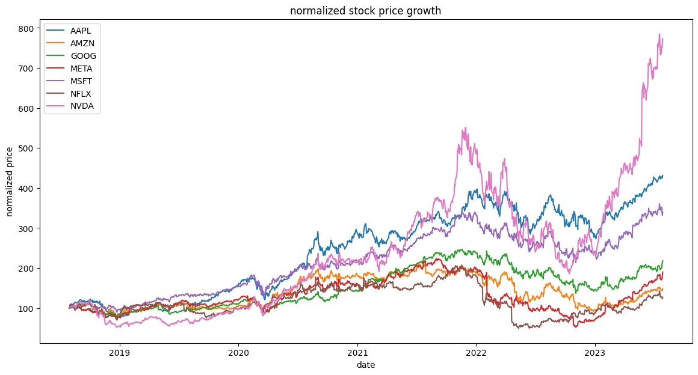
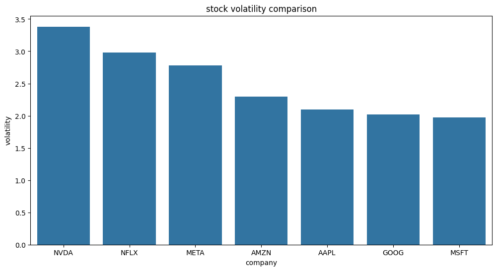
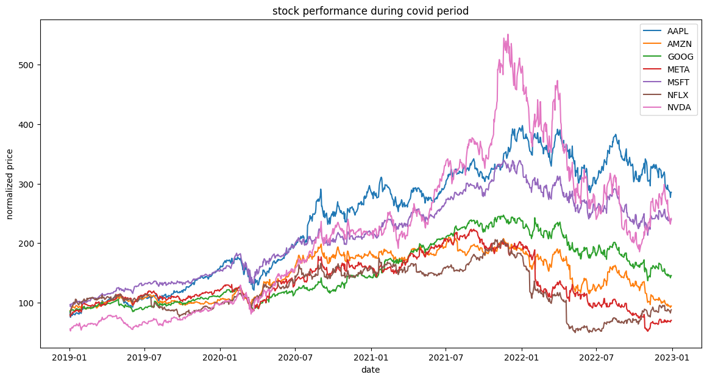
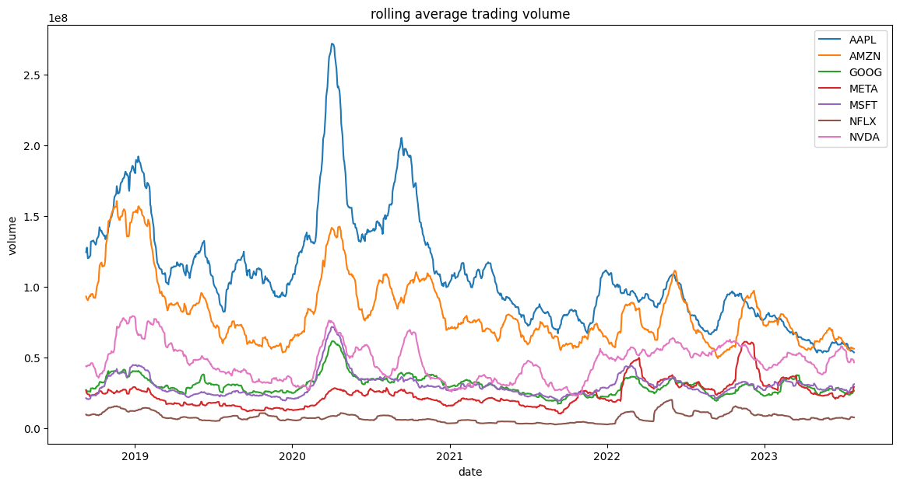

                                                                                        Проектная работа по майнору                                               
                                                                                        Тема: Анализ рынка акций                                              
Мой датасет MAANG stock prices(2018 - 2023) описывает ежедневные цены акций таких компаний, как: Microsoft, Apple, Amazon, Nvidia, Google, Netflix и Meta. Этот набор данных представляет собой ресурс для финансовых аналитиков, специалистов по обработке данных и энтузиастов фондового рынка. Я выбрал именно этот датасет, так как мне самому интересно было посмотреть на то, как росли и конкурировали самые крупные БигТех компании в мире, и с чем был связан их рост или падение. Для себя, я составил такой список вопросов к этому набору данных:
1) Какая компания показала наибольший рост стоимости акций в период с 2018 по 2023 год?
2) Какая компания показала лучшую волатильность(насколько акция падает или растет ежедневно, в процентах)?
3) Как кризис, вызванный ковидом в 2020-2022 годах, повлиял на рынок?
4) Как менялся объем продаваемых акций во время крупных рыночных событий?

Ответы на эти вопросы я дал в блокноте, тут лишь приведу пояснения, исходя из результатов анализа данных.

Вопрос 1:
Для ответа на данный вопрос, я стандартизировал стоимость акций, чтобы мы могли честно сравнить их рост, не глядя на начальную стоимость акций, которая могла сильно отличаться. Я брал сравнения именно по метрике Adj Close, так как она напрямую отображает стоимость акции в конце для, с учетом корпоративнывх событий, что позволяет определить реальную стоимость акции. Ниже следует график, демонстрирующий динамику цен на акции всех компаний из списка

Из графика видно, что данной компанией оказалась Nvidia, с большим отрывом. Далее, за ней идут Apple и Microsoft.
```
total growth percentage
NAME
NVDA    673.045167
AAPL    331.599629
MSFT    239.528732
GOOG    118.095652
META     90.272428
AMZN     48.615695
NFLX     27.113688
```
Вопрос 2:
Для ответа на этот вопрос, я посчитал дневное изменение цен на акции для каждой компании и взял их среднеквадратичные отклонения. После этого, получил в среднем на насколько акция отличается от своего среднего в процентах.

Из гистограммы видно, что самой волатильной компанией оказалась Nvidia. Это связано с тем, что компания была на подъеме и удивляла иновациями. Самой стабильной компанией оказалась Microsoft. Это объясняется размерами компании и их стабильностью в продуктовом плане, поэтому их рост более плавный.
```
company  volatility
NVDA    3.382384
NFLX    2.983595
META    2.782454
AMZN    2.297743
AAPL    2.098466
GOOG    2.020737
MSFT    1.971575
```

Вопрос 3:
Для ответа на этот вопрос я взял период времени с начала 2019 года до конца 2022 года, чтобы было видно динамику в 2020 году и рост/падение акций в начало данной трагедии.

Данный график показывает, что в начале кризиса в 2020 году, все компрании достаточно просели по стоимости акций, но так же резко начали расти, после падения. Лидерами роста были Nvidia и Apple, а к началу 2021 года, Apple вообще демонстрировали лучшие результаты по рыночной стоимости акций. Не смотря на спад в начале 2020 года, до 2021 года все компании вырасли в сравнении с началом 2019 года. В начале 2022 года Netflix, Amazon и Meta резко пошли на спад.

Вопрос 4:
Для того, чтобы оценить это, я брал количество проданных за день акций. Это число напрямую отражает какие-то события на рынке, например панику или интерес инвесторов к компании. Так как volume достаточно шумный, и значения могут сильно отличаться от одного дня к другому, я сгладил эти значения, чтобы получить лучшую оценку и график. Сделал я это с помощью того, что брал для каждого дня средний объем проданных акций за 30 прошедших дней. Это помогло получить меньше шума на графике. 

Из графика видно, что в периоды неопределенности на рынке, продажи подскакивали значительно, практически у всех компаний. Например, в период ковида. Рыночные тенденции влияли на продажи акций компаний Apple и Amazon больше всего, на протяжении всего периода. И все таки, лучшей в этом плане компанией оказалась Apple.   